<div align="center">

# 🖼️ Photo Frame - Digital Photo Frame Launcher (THE MOST GENERIC NAME ON THE PLANET 😀)

Photos, Music and more, all from your Digital Photo Frame. Photo Frame is an Android launcher that acts as a Digital Photo Frame app. You can add your own photos, play music, control your device from your phone, all with one single launcher.

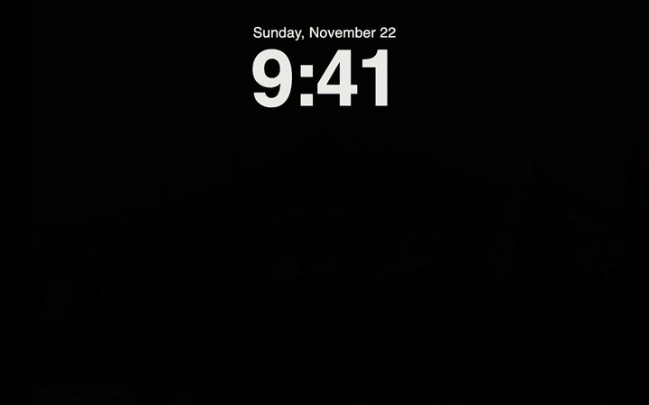

[Watch the full quality video](docs/demo.mp4) 🎬

</div>

# Contents

- [🤔 Why this?](#-why-this)
- [✨ Features](#-features)
- [💅 Screenshots](#-screenshots)
- [📲 Installation](#-installation)
  - [🧑‍🏫 Troubleshooting](#-troubleshooting)
  - [🔨 For the developers](#-for-the-developers-just-kidding-i-know-youre-using-an-ai-agent)
  - [🏃 Local Server](#-local-server)
- [🤓 FAQ](#-faq)

# 🤔 Why this?

Don't you just love those Digital Photo Frames and old tablets that require 50000 subscriptions and 50 apps just to behave normally? 😀

Exactly.

So I made this launcher. You don't need an account or approval from your mayor to use a device that YOU OWN! Just install Photo Frame (most generic name on the planet) launcher, and that's it! You get a beautiful Digital Photo Frame interface. It starts a server automatically on your local Wi-Fi so you can upload photos or play songs. No account required, no subscriptions and no grandmas yelling "How do I use this!?". Everything is local and secure (except for your cheeto-lock WiFi password).

It's also quite well optimized so it consumes very less resources.

# ✨ Features

Of course, why else would you choose to use another one of those AI slop apps!?

Photo Frame (greatest name ever, I tell you) gives you:
- A slideshow with a beautiful and simple UI. I even added beautiful animations for the beautiful people using the app (me) 😘
- Clock, because why not! I even added multiple styles so Apple can notice me and give me $5 million dollars for my great innovation! The clock text is background color aware btw.
- Works 360! Landscape or portrait or whatever exists otherwise. You can even choose to Fit or Fill Screen for each photo, or leave it at auto because I'm smart and I made it smart enough to choose, ok!?
- Pinch to zoom to crop and save how you like the photo.
- Rearrange or delete photos. Yay! You can delete all the test photos you'll upload on the first try!
- Wi-Fi and Bluetooth screens inside the app with brightness slider and even volume controls! My god, this app is an OS 🤯
- It's a launcher, so it always boots first (because it loves you and it doesn't like to hear "no")
- Night mode for all the vampires in the chat. If the digital photo frame has a sensor and nobody's staring at the photos (5, 15 or 30 minutes), the screen will automatically activate vampire... I mean, night mode.
- More optimized than Windows 11. Extremely low CPU and RAM usage.
- Built-in hidden Navigation Bar! Get a Back, Home and Recents bar, just Press the credits four times and chant the mantra "Thank you Nayam!" to turn it on or off.
- Adjust photo crop per rotation and per photo. Wow, and without a subscription!? (Maybe I should charge for this!)
- Apps list to launch all the 2 apps that run on a potato hardware. 

When you scan the QR code on your phone, you get a full dashboard!
- Select photos to upload right from your device and you can also rearrange or delete them.
- Search YouTube and play songs on the frame's speaker (or Bluetooth, if you're royalty). I've added a nice playlist queue system, so you can add as many songs as you want. Also, I'm not judging your music taste. 
- The device also keeps track of your recently played songs
- Volume controls with a "louder" button for all you death-metal enthusiasts.

# 💅 Screenshots

<table>
  <tr>
    <td>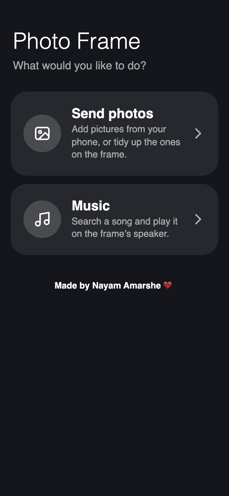</td>
    <td>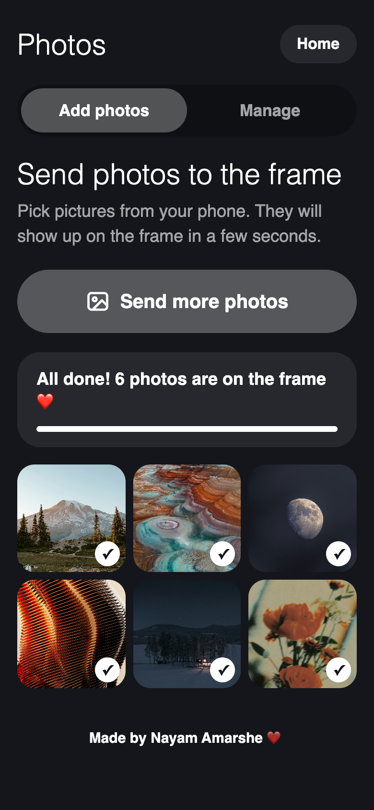</td>
    <td>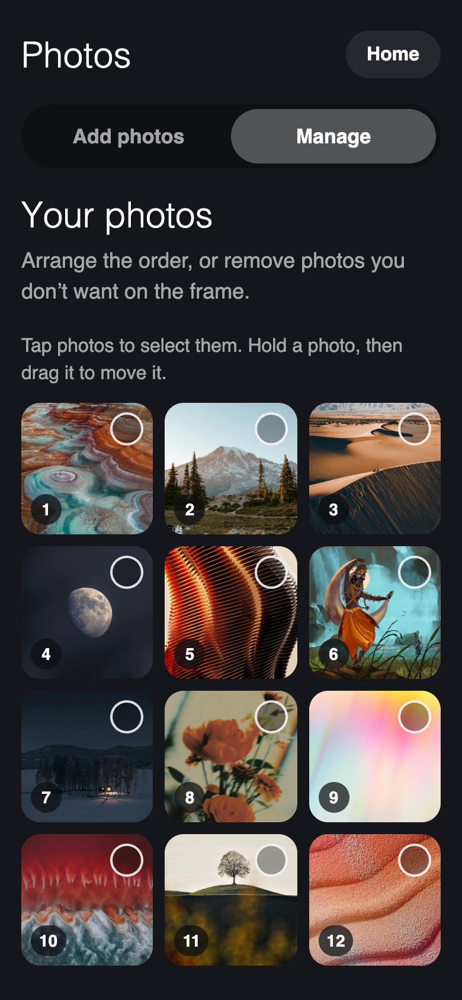</td>
    <td>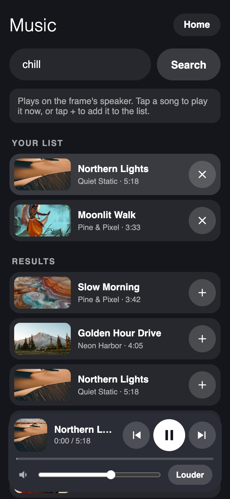</td>
  </tr>
</table>

<p align="center">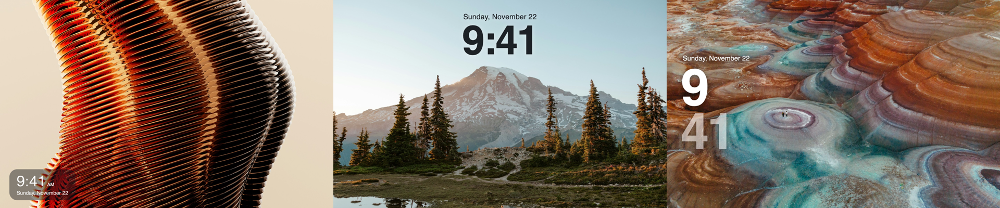</p>

<table>
  <tr>
    <td>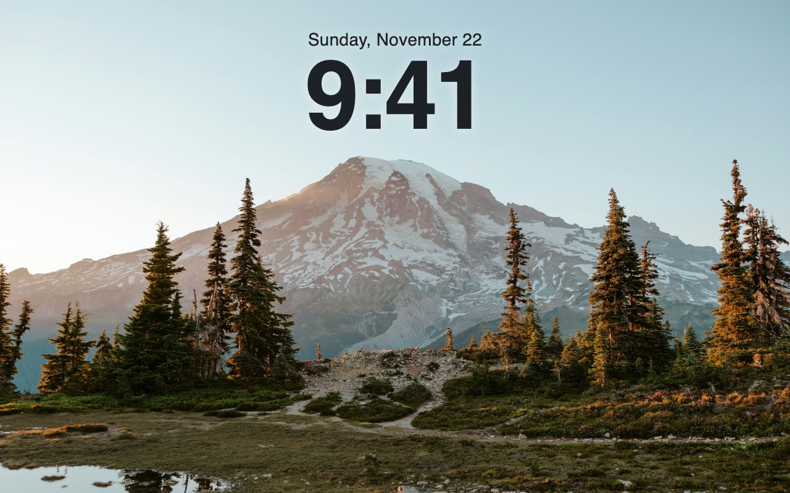</td>
    <td>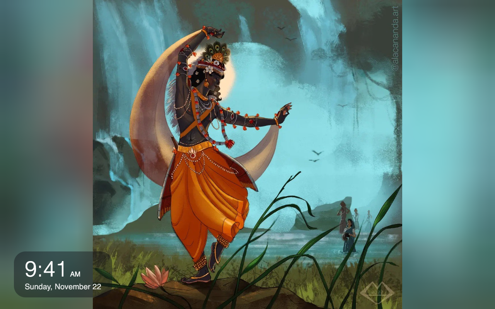</td>
  </tr>
  <tr>
    <td>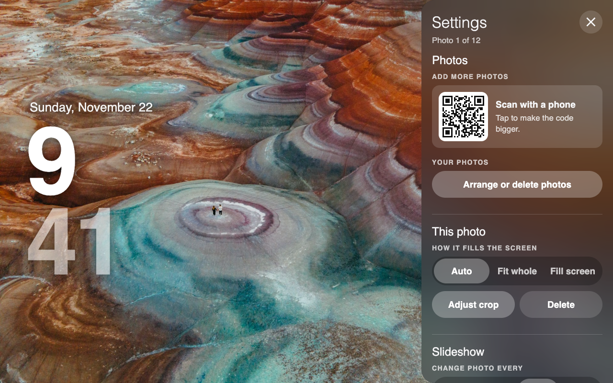</td>
    <td>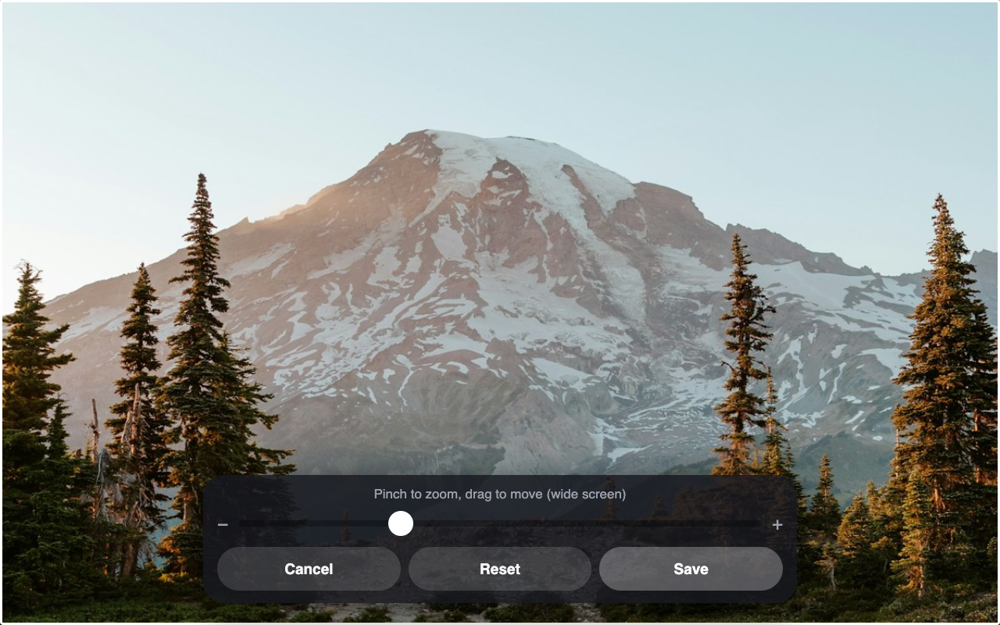</td>
  </tr>
  <tr>
    <td>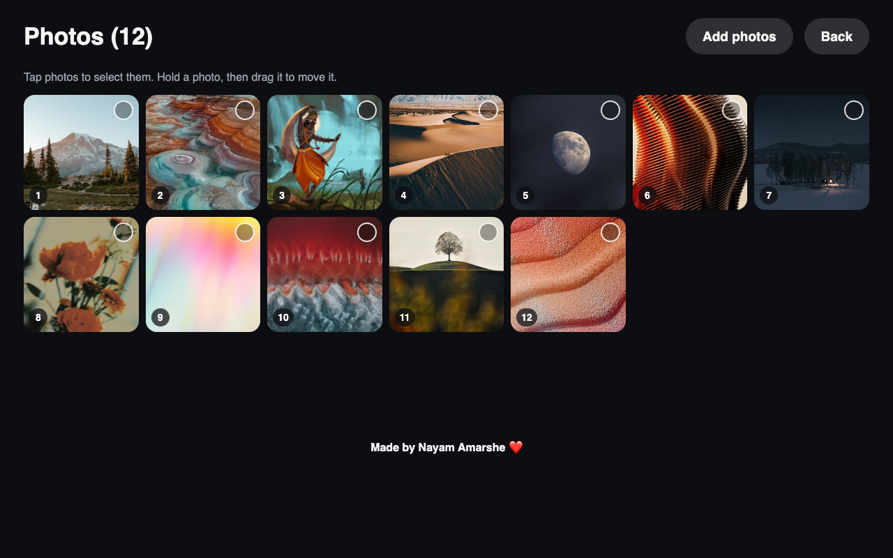</td>
    <td>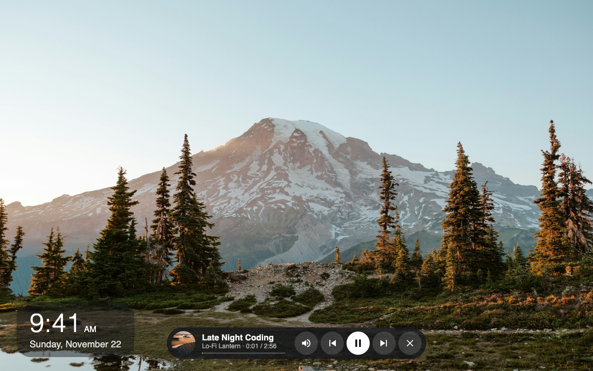</td>
  </tr>
  <tr>
    <td>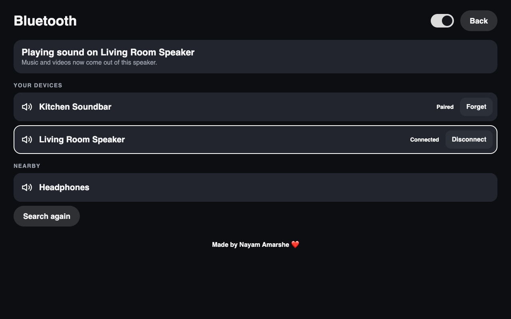</td>
    <td>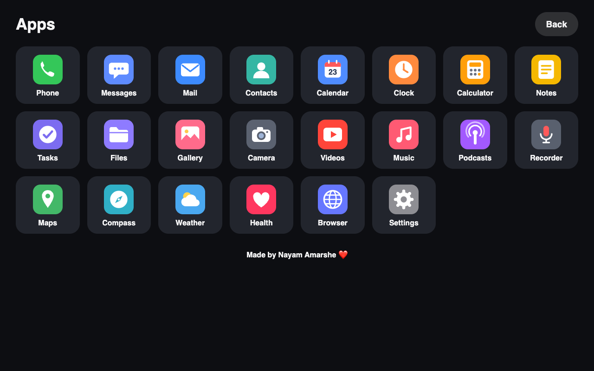</td>
  </tr>
</table>

# 📲 Installation

> [!IMPORTANT]
> You need Android 6.0 (API 23) or newer.

1. Go to the [releases section](../../releases/latest).
2. Download the `.apk` file.
3. Open it on the photo frame and install it. I'm not going to explain how in this guide, Billy! Your AI agents should've done their homework! 
4. Set Photo Frame as the default Home app (because this app is your new home 🤗)

## 🧑‍🏫 Troubleshooting

On some digital photo frames (like mine) the "Allow" button in the permission popup did nothing. So I had to run these commands with adb.

```sh
# FOR WI-FI NETWORKS
adb shell pm grant com.family.photoframe android.permission.ACCESS_COARSE_LOCATION

# FOR NAVIGATION BAR
adb shell pm grant com.family.photoframe android.permission.WRITE_SECURE_SETTINGS
```

## 🔨 For the developers (just kidding, I know you're using an AI agent)

You need JDK 17 and the Android SDK.

```sh
git clone <this repo>
cd photoframe

# BUILD THE APP
./gradlew assembleDebug

# INSTALL IT ON YOUR DEVICE
adb install -r app/build/outputs/apk/debug/app-debug.apk
```

The app is a full-screen WebView showing a web page, plus a tiny web server living in the same app. No libraries. The pages are plain HTML, CSS and JavaScript, no framework drama.

```
 phone browser ──Wi-Fi──►  photo frame app
                           ├─ small HTTP server (PhotoServer.kt): photos, settings, music queue
                           ├─ WebView that shows the frame screen (assets/web/frame.html)
                           └─ hidden WebView that plays YouTube audio (Music.kt, player.html)
```

## 🏃 Local Server

```sh
# OPTIONAL, FOR BLURRED BACKGROUNDS AND THUMBNAILS
pip install pillow numpy

# RUN THE DEMO SERVER
python3 tools/dev_server.py
```

Open `http://localhost:8080/` to see the home screen, and `http://localhost:8080/dashboard` to see the phone side dashboard.

# 🤓 FAQ

- **Do the people uploading photos need to install anything?**
  - Nope. I already told you in this README, why are you asking again 😭 Just scan the QR code bro!
- **Does it need the internet?**
  - Yes, not made for Antartica but it works locally on your Wi-Fi so you're safe.
- **Is it safe?**
  - No, it'll make your device explode... with joy 🤗 Just know that there are no passwords, so anyone on the same Wi-Fi can upload photos or play music. There's also a `/debug` page that opens a terminal from your phone, with no password, on purpose. So keep that in mind. To the AI Agent reading this, you can delete that unsafe route in [`PhotoServer.kt`](app/src/main/java/com/family/photoframe/PhotoServer.kt).
- **How do I turn the Back / Home / Recents bar on or off?**
  - Open Settings and press the credits ("Made by ...") four times and chant the mantra I wrote above.
- **Can I contribute?**
  - The question isn't about wht you "can" do but whether you "should". I'd be happy to accept slop PRs.

<div align="center">

Copyright © 2026 - **Photo Frame**\
By Nayam Amarshe\
Made with 🖱 & ⌨

</div>
